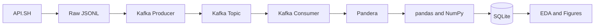

# Toyota Car Price Analysis: Comparing Market Listing Prices and KBB Fair Market Prices

> Replace every `[ACTUAL]` placeholder with output from the completed pipeline, then export this report to PDF.

## 1. Title page

Course, SIS 2, group number, members, contribution, submission date.

## 2. Introduction

The project compares active Toyota asking prices with the `kbb_fair_price` reference supplied in API.SH Autotrader responses. It asks which listings are below, near, or above the reference market price and how the difference varies by model, year, mileage, location, and vehicle characteristics.

## 3. Data source and collection

Document endpoint `GET https://api.api.sh/autotrader/v1/search`, headers, Toyota/ZIP/radius/page parameters, collection time, pagination, retries, errors, dataset dimensions, and examples. Original factual source values are preserved before transformation inside an envelope containing collection metadata; copyrighted descriptions and images are deliberately excluded.

- Collected records: [ACTUAL]
- Numerical fields: listing price, fair price, mileage, days on site, year
- Categorical fields: model, trim, condition, body style, state
- Date/time: UTC collection time and documented estimated first-seen time

## 4. Architecture

Explain the Kafka `run_id` header and expected-count termination condition.

## 5. Kafka

Describe Docker/KRaft broker, topic, JSON serialization, separate producer and consumer, acknowledgements, error handling, and actual evidence.

- Published: [ACTUAL]
- Consumed: [ACTUAL]

## 6. Pandera

Pandera validation was applied to the 250 messages consumed from Kafka, before any cleaning. Six records (2.4%) failed the rule fair_market_price > 0. In all six cases the API returned kbb_fair_price = 0.0 (and a fair range of 0.0–0.0), which is a placeholder for an unavailable estimate rather than a real price. 

All six are 2026 Toyota Corolla listings from the same dealer (Group 1 Toyota North Austin) and have no deal rating. Using them would have produced a −100% price difference, so they were quarantined in artifacts/invalid_records.csv with their errors in artifacts/validation_errors.csv and excluded from cleaning, SQLite storage and analysis.

 The remaining 244 records passed all nine rules. In addition, three deliberately invalid test records (negative price, wrong make, malformed VIN) were detected and excluded.

## 7. Cleaning and transformation

Describe missing values, duplicates, type conversion, text normalization, UTC dates, NumPy calculations, the 3% tolerance, multi-condition filtering, GroupBy, and pivot table. Explain why `estimated_first_seen_at` is approximate.

## 8. SQLite and idempotency

Describe the schema, primary key, checks, upsert, SQL verification queries, and two identical loads.

- First load count: [ACTUAL]
- Second load count: [ACTUAL]
- Digest unchanged: [ACTUAL]

## 9. EDA

Insert and interpret only actual generated figures:

1. `01_listing_vs_fair_price.png`
2. `02_difference_by_model.png`
3. `03_pricing_status.png`

Report sample sizes and descriptive statistics. Do not imply causation.

## 10. Pipeline verification

Copy every count from `artifacts/pipeline_audit.json` and explain differences between collected, published, consumed, valid, cleaned, and stored records. Include test output and encountered errors.

## 11. Conclusions and limitations

Summarize actual findings. Limitations include one geographic radius, active-listing selection, third-party fair-price methodology, unavailable fair prices, approximate first-seen dates, API/data-source changes, and asking prices rather than transaction prices.

## 12. Individual contributions

[MEMBER NAMES AND ACTUAL RESPONSIBILITIES]

## 13. References

- API.SH Car Data API and Terms of Service.
- Autotrader source listings.
- Official documentation for Kafka, Pandera, pandas, NumPy, SQLite, Matplotlib, and Seaborn.
